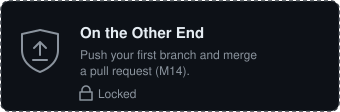
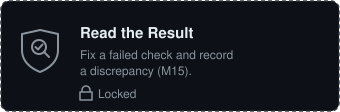
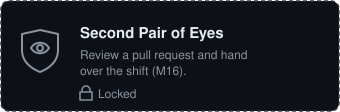

# Ring A Docking Log · December 8, 2085

<!-- gitquest:badges:start -->
<p>



</p>
<!-- gitquest:badges:end -->

The Aster is bringing Ring A's relief crew, and it's running late. Tonight you
work from your own computer. Docking, Maintenance and Continuity leave requests
here; you send your changes back with Git.

> Voss, Mika and the notices are **scripted training characters**, posted by
> GitHub's Actions bot. Nobody is reading in real time.

<!-- gitquest:progress:start -->
## Your shift

Not started yet. Open **Actions → Station control → Run workflow** to begin.
<!-- gitquest:progress:end -->

## Quick start

1. **Make your copy:** **Use this template → Create a new repository**, set to **Public**.
2. **Allow pull requests from Actions:** in your copy, **Settings → Actions → General**,
   choose **Read and write permissions**, tick **Allow GitHub Actions to create and approve pull requests**, and save.
3. **Get Git ready** on your computer. [How?](#setting-up-git)
4. **Clone your copy** (not the template), and open the folder in your editor.
5. **Start the shift:** **Actions → Station control → Run workflow**. your first task, **M14.1**, appears under **Issues**.

That's all you need. Everything else is explained as you go, in the story.


*Creating your copy from the template*

## Where things are

| Tab | What's there |
|---|---|
| **Issues** | Your tasks, one small issue each (M14.1, M14.2, ...). Tick the boxes yourself and close each one when someone on shift confirms it |
| **Pull requests** | Changes waiting to be read and merged |
| **Actions** | Automatic jobs: **Station control** runs the story, **Record checks** checks your records |
| **Code** | The files |

## Setting up Git

You need two things: a **name and email** for your commits, and a way to
**sign in** to GitHub when you push. They're separate.

```bash
git config --global user.name "Your Name"
```

```bash
git config --global user.email "you@example.com"
```

<details>
<summary><strong>Signing in: Windows</strong></summary>

Install [Git for Windows](https://git-scm.com/download/win) with the default
options. The first time you push, a browser window asks you to sign in.

</details>

<details>
<summary><strong>Signing in: macOS or Linux</strong></summary>

Install [GitHub CLI](https://cli.github.com/), then run `gh auth login` and
choose the browser option.

</details>

Never paste a password or token into GitQuest, an issue, or a file here.


*Signing in through the browser from a terminal*

<details>
<summary><strong>Cloning, and checking you cloned the right one</strong></summary>

On **your** repository's page, choose **Code**, copy the URL, then:

```bash
git clone https://github.com/YOUR-NAME/YOUR-REPOSITORY.git
```

Inside the new folder, `git remote -v` should show **your** repository. If it
shows the template, clone your copy instead.


</details>

## If you get stuck

Every step has a **Stuck?** section with three levels of hints. Mistakes are
part of the shift: nothing here needs you to delete the repository.

| Problem | Fix |
|---|---|
| No first mission, or lost your place | **Actions → Station control → Run workflow**. Its summary links where you are. |
| `git push` says "no upstream branch" | First push of a new branch: `git push -u origin BRANCH-NAME` |
| A check failed | Open **Details** next to **Record checks**, read the red step, fix, commit, push. |
| Pushed or merged straight to `main` | Station control undoes it (your commit stays in the history) and Voss posts a checklist: pull, new branch, pull request. |
| Merged a pull request too early | Voss reopens the task with a checklist for a new pull request. Wait for **Record checks** before merging: the green **Story update** tick isn't a check of your record. |
| Pressed GitHub's **Revert** on a merged pull request | Allowed, but not needed. Voss suggests closing it and fixing forward with a new pull request; merging it is fine too. |
| `git pull` says *divergent branches* or *Not possible to fast-forward* | You committed on `main` by mistake. Every "Start from the latest main" step has a fold that moves the commit to a branch. |
| Deleted a branch before its pull request merged | If it's still on your computer, push it again: `git push -u origin BRANCH-NAME`. |
| Closed a mission by hand | **Run workflow**. It reopens what isn't finished. |

Every task is a safe place to stop. Come back any time.

<details>
<summary><strong>Record formats (reference)</strong></summary>

| File | Format |
|---|---|
| `docking-log/arrivals.md` | `2085-12-08 22:40 \| Aster \| Bay 3` |
| `docking-log/plans/aster.md` | `Ship`, `Date`, `Expected`, `Proposed bay`, `Status`, `Condition` as `Name: value` |
| `docking-log/handover/2085-12-08.md` | `Ship`, `Expected`, `Bay`, `Bay status` (`Hold` or `Released`), `Instruction` |
| `docking-log/notices/` | Station-authored. Read them; don't edit them |

Times are always 24-hour `HH:MM`, like `22:40`. Only change the file your task
names; `.github/`, `scripts/` and `.gitquest/` are station equipment.

</details>

## When you're done

Station control posts **Stage complete**. Go back to GitQuest with this
repository's URL. To start over, delete this repository and make a new copy.
